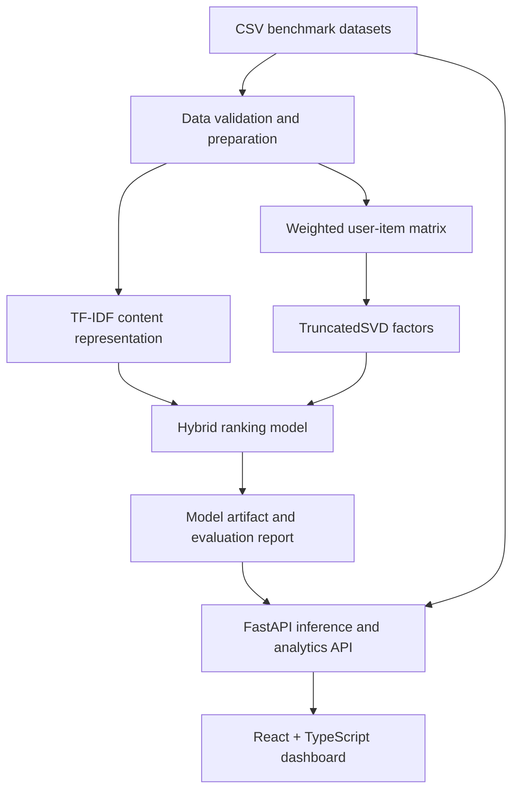
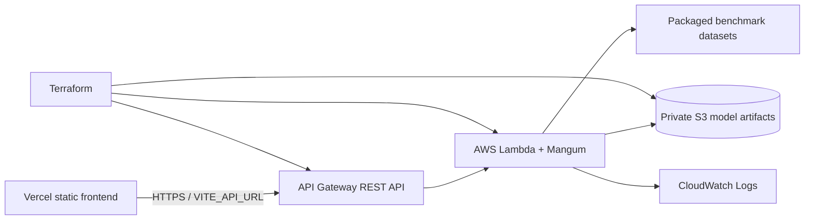

# Streamwise

**A hybrid recommendation and streaming analytics platform built with Python, React, and AWS.**

Streamwise ranks unseen titles for a user by combining content similarity with collaborative signals learned from historical interactions. The repository includes a reproducible synthetic benchmark, model training and evaluation, a FastAPI inference service, a React analytics workspace, Docker packaging, Terraform infrastructure, and CI checks.

> **Dataset notice:** the checked-in user profiles, catalog, and interaction events are generated synthetic data. They are provided for repeatable engineering experiments, not as real customer data. Model metrics are benchmark measurements on this dataset, not production performance claims.

## Architecture

### Local application



### AWS deployment path



The local Docker image serves the built React application and FastAPI from one container. The AWS path packages FastAPI for Lambda through Mangum; Terraform provisions API Gateway, Lambda, the dependency layer, a private versioned S3 model bucket, IAM permissions, and CloudWatch log retention. AWS resources are not considered deployed until `terraform apply` succeeds and the deployed API is smoke-tested.

## Machine learning

The recommendation model combines two signals:

| Component | Method | Weight | Input |
|---|---|---:|---|
| Content-based | TF-IDF cosine similarity | 45% | Title, genre, content type, language, studio |
| Collaborative | TruncatedSVD latent factors | 55% | Weighted positive user-item interactions |

Positive event weights are defined in `backend/ml/hybrid.py`. Previously interacted titles are filtered from recommendation results. Users with no positive training interactions use their declared preferred genre and catalog popularity as a cold-start content signal.

The training command performs a deterministic per-user holdout split of unique positive user-item pairs. It reports Precision@10, Recall@10, and NDCG@10 for the hybrid model and a popularity baseline. The final model is trained on all available positive interactions and saved as a pickle artifact.

**Score semantics:** recommendation scores are relative ranking values, not calibrated probabilities. The project does not claim that a score of `0.8` means an 80% chance of viewing.

### Included benchmark data

| File | Records | Purpose |
|---|---:|---|
| `data/raw/user_profiles.csv` | 500 | User attributes and preferred genre |
| `data/raw/content_catalog.csv` | 240 | Streaming title metadata |
| `data/raw/user_interactions.csv` | 27,613 | Timestamped playback and engagement events |

Regenerate the benchmark deterministically:

```bash
python -m dataset.generate --seed 42
```

## Technology stack

- **Frontend:** React 18, TypeScript, Vite, Recharts, Lucide
- **API:** Python 3.12, FastAPI, Pydantic
- **Machine learning:** pandas, NumPy, SciPy, scikit-learn
- **Cloud:** AWS Lambda, API Gateway, S3, CloudWatch, IAM
- **Infrastructure as Code:** Terraform
- **Containerization:** Docker, Docker Compose
- **CI:** GitHub Actions, pytest, Ruff, TypeScript build, Terraform validation, Docker build

## Repository structure

```text
streamwise/
├── api/                         # AWS Lambda + Mangum entrypoint
├── artifacts/                   # Trained recommender and evaluation report
├── backend/
│   ├── main.py                  # FastAPI routes and application setup
│   └── ml/
│       ├── hybrid.py            # Hybrid recommender implementation
│       └── train.py             # Training and offline evaluation
├── data/raw/                    # Synthetic benchmark CSV files
├── dataset/generate.py          # Reproducible dataset generator
├── frontend/                    # React + TypeScript application
├── infrastructure/              # AWS Terraform configuration
├── machine_learning/README.md   # Model methodology and training notes
├── scripts/package_lambda.py    # Build Lambda function and dependency layer
├── tests/                       # API and inference tests
├── Dockerfile
├── docker-compose.yml
├── requirements.txt
└── requirements-dev.txt
```

## Run locally

### Prerequisites

- Python 3.12
- Node.js 22 or later
- npm
- Docker (optional, for containerized execution)

### 1. Install Python dependencies

From the repository root:

```bash
python -m venv .venv

# macOS / Linux
source .venv/bin/activate

# Windows PowerShell
.venv\Scripts\Activate.ps1

python -m pip install --upgrade pip
pip install -r requirements-dev.txt
```

### 2. Train the model

```bash
python -m backend.ml.train
```

This writes `artifacts/hybrid_recommender.pkl` and `artifacts/metrics.json`. The included artifact is provided for a quick start; retrain after changing the source data or model implementation.

### 3. Start the API

In terminal 1:

```bash
uvicorn backend.main:app --reload --host 127.0.0.1 --port 8000
```

API documentation is available at `http://127.0.0.1:8000/docs`.

### 4. Start the frontend

In terminal 2:

```bash
cd frontend
npm install
npm run dev
```

Open `http://localhost:5173`. Vite proxies `/api` requests to the local FastAPI service on port `8000`; no frontend environment variable is required for local development.

### 5. Run tests and checks

```bash
pytest -q
ruff check backend dataset scripts tests api

cd frontend
npm run typecheck
npm run build
```

## Docker

Build and run the complete application (React static build + FastAPI API) in one container:

```bash
docker compose up --build
```

Open `http://localhost:8000`. The container runs as a non-root user. `/healthz` is the liveness endpoint and `/readyz` verifies that the dataset and trained model are available; the container health check uses `/readyz`. To build without Compose:

```bash
docker build -t streamwise:local .
docker run --rm -p 8000:8000 streamwise:local
```

## API reference

| Method | Endpoint | Purpose |
|---|---|---|
| `GET` | `/healthz` | Liveness check |
| `GET` | `/readyz` | Readiness check for dataset and model artifact |
| `GET` | `/api/overview` | Dataset KPIs and interaction distributions |
| `GET` | `/api/datasets` | Dataset inventory and quality counts |
| `GET` | `/api/datasets/{name}/preview` | Read-only CSV preview |
| `GET` | `/api/datasets/{name}/profile` | Column-level EDA and descriptive statistics |
| `GET` | `/api/users` | Benchmark user lookup |
| `GET` | `/api/content` | Content catalog lookup |
| `GET` | `/api/model/status` | Model artifact status |
| `GET` | `/api/model/metrics` | Offline evaluation report |
| `GET` | `/api/recommendations/{user_id}` | Ranked unseen titles for a user |
| `POST` | `/api/recommendations/score` | Explain a user-title hybrid score |
| `GET` | `/api/forecast/{content_id}` | Statistical forecast from observed playback history |

Forecast methods are explicit statistical baselines (`moving_average`, `linear_trend`, `seasonal_naive`). Forecast dates begin after the latest timestamp available for the selected title, rather than assuming the benchmark is current. They are not part of the hybrid recommendation model and are not described as trained ML forecasting models. A title without observed play/completion history returns an unavailable response; the API does not generate random fallback values.

## AWS deployment with Terraform

The Terraform deployment uses a Lambda-compatible dependency layer. Build the deployment assets from the repository root first:

```bash
python scripts/package_lambda.py
```

This command uses the official AWS Lambda Python 3.12 container to build ABI-compatible dependencies, prunes test-only files, checks the Lambda uncompressed package limit, and packages the FastAPI application, benchmark CSV files, and Mangum entrypoint. Docker and internet access to the Python package index are required for the dependency build.

Then provision the AWS resources:

```bash
cd infrastructure
terraform fmt -recursive
terraform init
terraform validate
terraform plan
terraform apply
```

After apply, retrieve the API base URL:

```bash
terraform output -raw api_url
```

For a static Vercel frontend, configure the Vercel project with **Root Directory** set to `frontend`, set `VITE_API_URL` to the API Gateway URL (including the stage, for example `/dev`), and set `cors_origins` in Terraform to the exact deployed frontend origin before applying. The default Terraform CORS origin is `*` for initial testing; use an explicit origin for a public deployment.

Terraform provisions billable AWS resources. Review the plan and estimated costs before applying. Destroy resources when finished:

```bash
terraform destroy -var='force_destroy_bucket=true'
```

The destroy flag explicitly permits Terraform to empty the versioned model bucket, including noncurrent object versions. Review the target workspace and state before using it.

### Infrastructure notes

- S3 model artifacts are private, encrypted, and versioned.
- Lambda reads the model artifact from S3 using a least-privilege read policy.
- API Gateway proxies requests to the FastAPI application through Mangum.
- API Gateway throttling and CloudWatch log retention are configurable.
- The API currently uses the synthetic benchmark dataset packaged with the Lambda. It is not a live streaming ingestion system and does not ingest real user events.
- The API is unauthenticated by default and is intended for a synthetic public demo. For real user data, add an authentication/authorization layer and stricter network and data controls before deployment.

## CI pipeline

GitHub Actions validates the Python API and model code, executes pytest, type-checks and builds the React application, validates Terraform configuration, and builds the Docker image. CI does not run `terraform apply` or deploy AWS resources automatically.

## Configuration

| Variable | Default | Description |
|---|---|---|
| `DATA_DIR` | `./data/raw` | Directory containing the three benchmark CSV files |
| `ARTIFACT_DIR` | `./artifacts` | Local model and metrics directory |
| `CORS_ORIGINS` | `http://localhost:5173,http://127.0.0.1:5173` | Comma-separated allowed browser origins |
| `MODEL_BUCKET` | unset | Optional S3 bucket for the Lambda model artifact |
| `MODEL_KEY` | `models/hybrid_recommender.pkl` | S3 key for the trained model |
| `METRICS_KEY` | `models/metrics.json` | S3 key for the evaluation report |
| `VITE_API_URL` | empty | API base URL for the React frontend |

Never commit `.env`, AWS credentials, Terraform state, or secret values.
