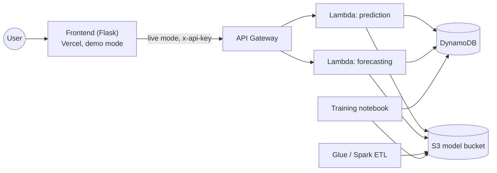

# Streamwise

Stream prediction and demand forecasting on AWS, with infrastructure as code, a CI/CD pipeline and a one-command demo deployment.

Streamwise scores how likely a user is to stream a title (hybrid recommender) and forecasts daily streams for a title (four time-series methods).

> The frontend is deployed on Vercel in **demo mode**. The production architecture is designed for AWS and provisioned with Terraform (`infrastructure/`). It is validated in CI but not applied by default.

## Architecture



In demo mode the frontend answers from a deterministic synthetic backend and never calls AWS.

## Repository layout

| Path | What it is |
|------|------------|
| `web/` | Flask app and UI (`demo.py` synthetic backend, `live.py` AWS backend) |
| `api/index.py`, `vercel.json` | Vercel entrypoint and routing |
| `infrastructure/` | Terraform: S3, DynamoDB, IAM, Lambda, API Gateway, usage plan and API key |
| `services/lambda/` | `prediction` and `forecasting` Lambda handlers |
| `ETL/` | AWS Glue / Spark job |
| `machine_learning/` | Training notebook (TF-IDF + SVD hybrid recommender) |
| `dataset/` | Synthetic dataset generator |
| `tests/` | pytest suite for the web app |
| `.github/workflows/ci-cd.yml` | Lint, tests, Terraform validate, Docker smoke test, optional Vercel deploy |

## Run it locally

The app has two modes, set by `APP_MODE`: `demo` (default, no AWS or credentials) and `live` (proxies to API Gateway).

```bash
cp .env.example .env
python -m venv .venv && source .venv/bin/activate
pip install -r requirements-dev.txt
python -m web.app            # http://127.0.0.1:8000
pytest -q && ruff check .
```

With Docker:

```bash
docker build -t streamwise .
docker run --rm -p 8000:8000 streamwise      # http://localhost:8000
# or: docker compose up --build
```

## Configuration

| Variable | Default | Notes |
|----------|---------|-------|
| `APP_MODE` | `demo` | `demo` or `live` |
| `PREDICTION_API_URL` | none | live: API Gateway stage URL (Terraform output `api_url`) |
| `FORECAST_API_URL` | none | live: same URL |
| `API_GATEWAY_KEY` | none | live: sent as `x-api-key` (Terraform output `api_key`) |
| `REQUEST_TIMEOUT` | `10` | live: seconds before an upstream call fails |
| `PORT`, `LOG_LEVEL` | `8000`, `INFO` | local server |

The web app needs no AWS credentials, only the API Gateway URL and key. Never commit `.env`.

## Infrastructure (Terraform)

`infrastructure/` provisions, per environment:

- S3 bucket for model artifacts (private, versioned, encrypted)
- Four DynamoDB tables (on-demand billing, encrypted, point-in-time recovery): users, content embeddings, stream history, user interactions
- Two Lambda functions (Python 3.12) packaged from `services/lambda/`, each with its own least-privilege IAM role (read-only on the tables and model bucket) and a CloudWatch log group with 14-day retention
- A regional REST API with `POST /predict` and `POST /forecast`, both requiring an API key, plus a usage plan (5 req/s, 1000 req/day by default)

```bash
cd infrastructure
terraform init
terraform plan
terraform apply
terraform output api_url          # PREDICTION_API_URL and FORECAST_API_URL
terraform output -raw api_key     # API_GATEWAY_KEY
```

After applying, upload `hybrid_model.pkl` and `forecasting_model.pkl` to the `models/` prefix of the bucket from `terraform output model_bucket`, and point the training notebook and ETL at the table and bucket names Terraform outputs. Terraform names tables `<project>-<env>-<name>`, so update the hard-coded `ContentEmbeddings` in the notebook.

State is local by default. For shared use, add an S3 backend with DynamoDB locking.

## CI/CD

On every push and pull request, `ci-cd.yml` runs:

1. `ruff check` and `pytest`
2. `terraform init -backend=false` and `terraform validate` in `infrastructure/`
3. `docker build` and a `/healthz` smoke test of the container
4. Optional deploy to Vercel, only after 1 to 3 pass

## Deploy the frontend to Vercel

1. Push this repo to GitHub.
2. In Vercel, **Add New Project**, import the repo, keep the defaults. `vercel.json` handles the rest.
3. Leave `APP_MODE` unset for the demo. For the real backend, set `APP_MODE=live` plus the three variables above in Project Settings.

To deploy from Actions instead of Vercel's Git integration, set the repo variable `ENABLE_VERCEL_DEPLOY=true` and the secrets `VERCEL_TOKEN`, `VERCEL_ORG_ID`, `VERCEL_PROJECT_ID`. Pull requests then get previews and `main` goes to production.

## Backend API

| Endpoint | Body | Notes |
|----------|------|-------|
| `POST /api/predict` | `user_id`, `content_id`, `context.user_state` | `prediction_percentage`, `confidence`, `factors`, `recommendation` |
| `POST /api/forecast` | `content_id`, `periods` (1-365), `method` | `moving_average`, `exponential_smoothing`, `linear_trend`, `seasonal` |
| `GET /healthz` | none | `{"status": "ok", "mode": ...}` |

## Roadmap

- Remote Terraform state and a `terraform plan` job using GitHub OIDC
- Deploy the Lambdas from CI
- CloudWatch dashboards and alarms
